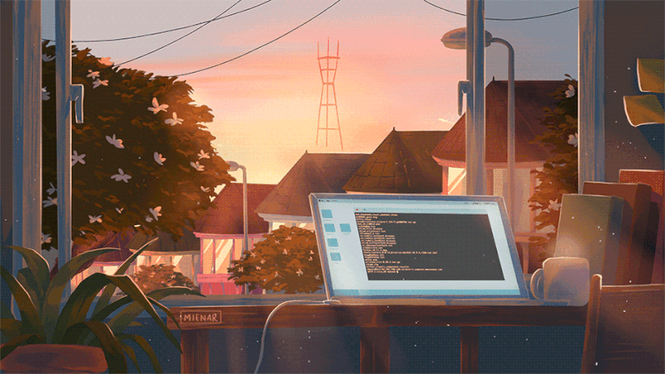

<div align="center">




`[ SYSTEM STATUS: ONLINE ]` ` [ LOCATION: Paris ]`

</div>

---

### ⌁ 01 / IDENTITY

```bash
$ whoami

Name       : Allae
Role       : Full-Stack Developer
Speciality : Web Development
Focus      : Cybersecurity
OS         : Linux
Status     : Always learning...
```

Développeuse web passionnée par la création d'applications et les technologies numériques. Actuellement en formation en cybersécurité, j'explore également l'administration système, les réseaux et la sécurité des infrastructures.

---

### ⌁ 02 / TECH ARSENAL

**// FRONT-END**

<p>

</p>

**// BACK-END & DATABASE**

<p>

</p>

**// CYBERSECURITY & SYSTEMS**

<p>

</p>

**// TOOLS & ENVIRONMENT**

<p>

</p>

---

### ⌁ 03 / CYBERSECURITY DIVISION

```text
[ SYSTEMS ]
> Linux / Ubuntu
> Windows Server
> Active Directory / GPO

[ NETWORKS ]
> TCP/IP / VLAN
> Routing / ACL
> Network Analysis

[ SECURITY ]
> Nmap / Kali Linux
> Responder / Lynis
> SSH / Fail2ban
> Server Hardening

[ VIRTUALIZATION ]
> Proxmox / VMware
> Cisco Packet Tracer
```

---

### ⌁ 04 / CURRENT MISSIONS

| Mission | Status |
|:---|:---|
| Full-Stack Development | `ACTIVE` |
| Cybersecurity | `IN PROGRESS` |
| Linux Administration | `LEARNING` |
| Network Security | `LEARNING` |

---

### ⌁ 05 / GITHUB DATA

<div align="center">


---

<div align="center">

Allae © 2026

</div>


